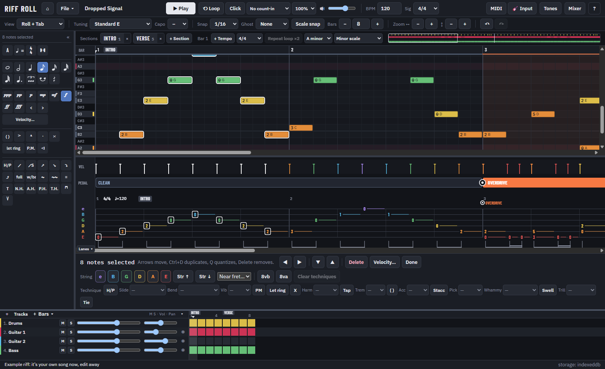
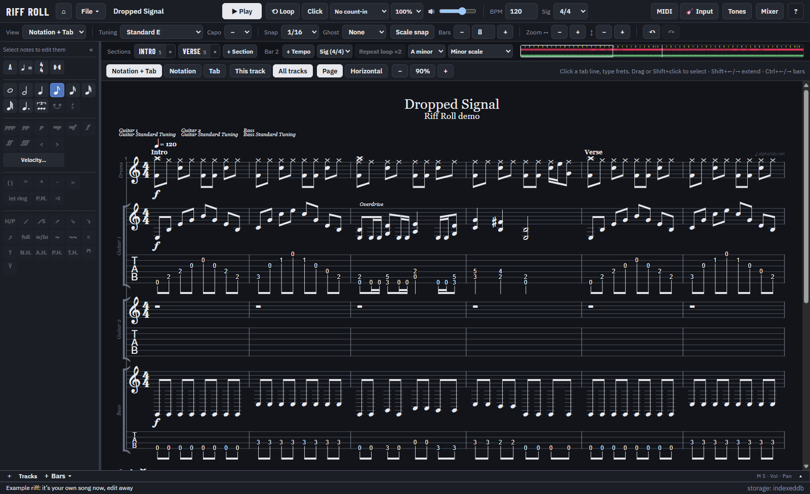
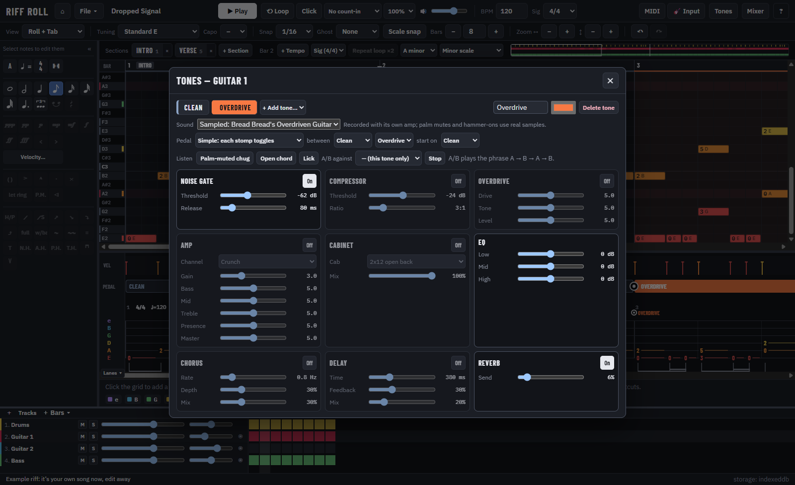
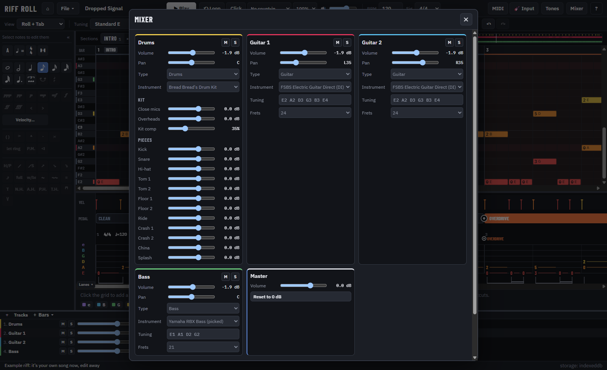
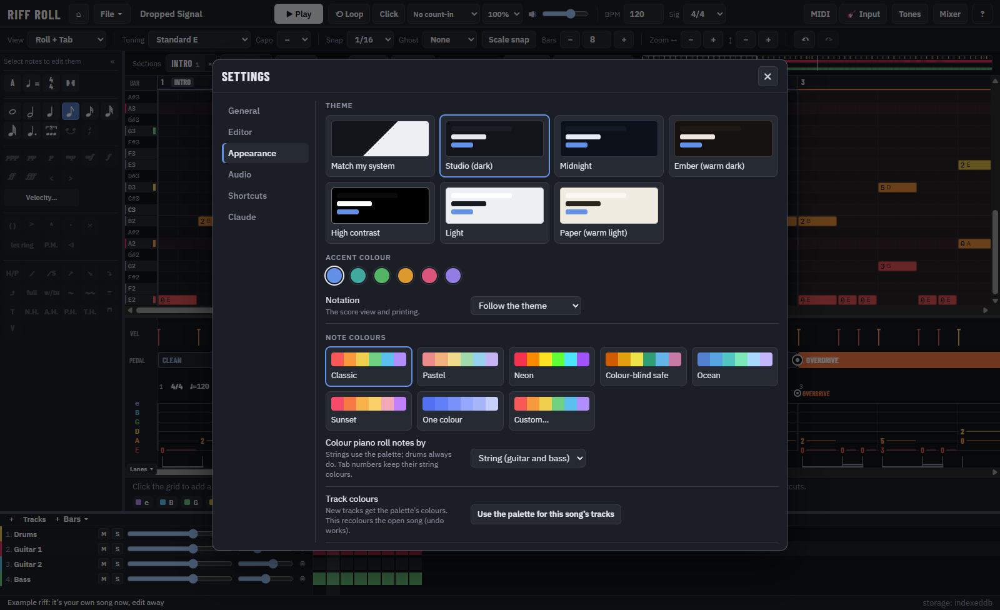
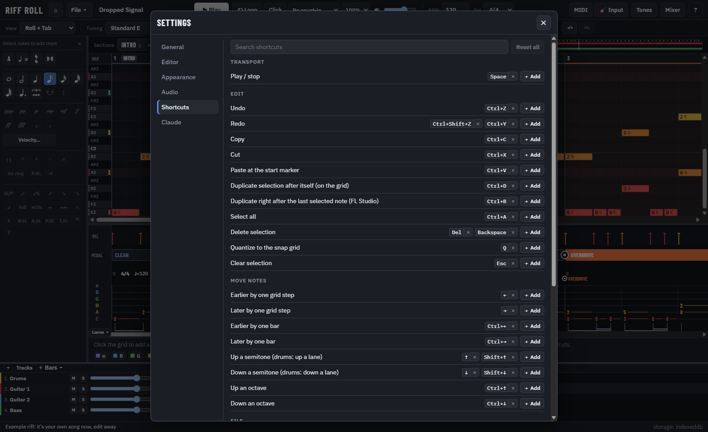
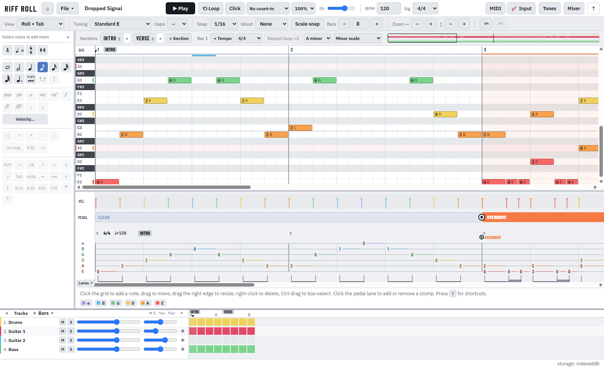
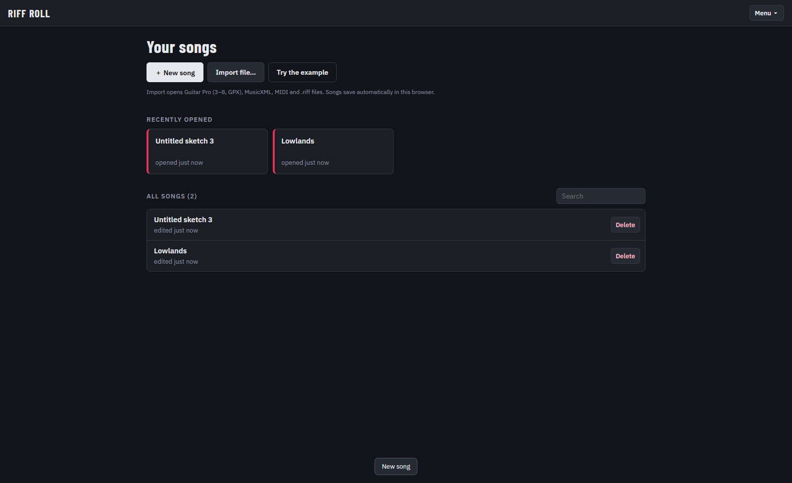
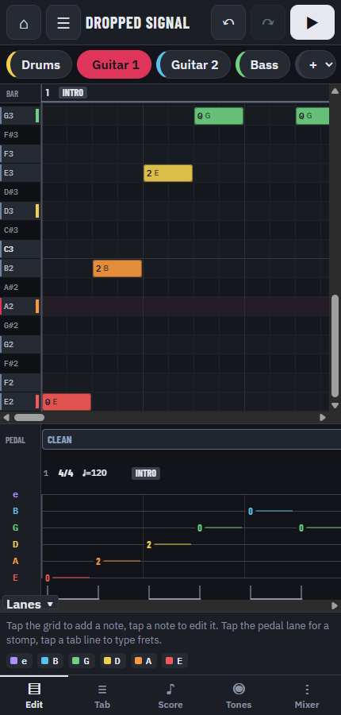

# Riff Roll

Songwriting for rock bands. Draw a riff in an FL Studio–style piano roll and get colour-coded Guitar Pro–style tab
with frets and note names, or write it straight into the tab and the score. Drop a stomp on the pedal lane to go from
clean to overdriven in the same guitar track. Add drums and bass, hear the song through sampled instruments, save it,
export it, print it, or let Claude write parts with you.

It runs two ways from one codebase: as a **Docker** web app and as a **desktop app** for Windows, macOS and Linux.


## Features

### Piano roll, tab and score, all one song

The piano roll, tab, notation and drum grid all show the same notes: an edit in one view appears in all of them, and
undo/redo covers every edit, including stomps, tempo and track settings.

- **Piano roll → tab.** A fingering engine picks string and fret for every note. It keeps riffs in one position,
  puts power chords on neighbouring strings and avoids strings that are still ringing. Notes are coloured by string.
  Click a note to see every place it can be played and pin it to one, or use **Auto**.
- **FL Studio editing**: click to add, drag to move, drag the edge to resize, right-click to delete, ←/→ a grid step
  (Ctrl: a bar), Shift+↑/↓ a semitone, Ctrl+↑/↓ an octave, **Ctrl+B** duplicates the selection right after its last
  note (press again to keep going), Ctrl+D duplicates on the grid, Alt+drag duplicates, Shift/Ctrl-drag box-selects.
  Scale shading and snap to scale, ghost notes from another track, and separate horizontal and vertical zoom.
- **Tab editor**: keyboard entry like Guitar Pro (arrows, frets, durations, dots, triplets, rests, ties, insert/delete
  beat) and techniques (hammer/pull, slides, bend curves, vibrato, palm mute, let ring, dead notes, harmonics,
  tapping, tremolo picking, ghost notes, accents, staccato, pick direction, whammy, volume swell, trills).
- **Bulk edits**: with several notes selected, the technique buttons apply to all of them, and the inspector puts them
  on one string, a string up or down, near a fret, an octave up or down, or clears their techniques. Bulk velocity
  (set, scale, add, ramp, humanize) and Alt+drag to draw velocities.



### Notation like Guitar Pro

The score view (alphaTab) is edited like Guitar Pro: click a tab line to put the cursor on that string and type frets,
click the score to put it on a beat, drag or Shift+click to select beats (Shift+←/→ extends, Ctrl+←/→ jumps bars), and
the edit palette and shortcuts work on the selection. Show notation + tab, notation only or tab only, this track or the
full score (click any staff to edit that track), page or horizontal layout, and zoom. A playback cursor follows the
music.

| Notation + tab, a bar selected | The full score |
|---|---|
|  |  |

### Drums, tones and mixing

- **Drum grid** with every kit piece and articulation, velocity lane, box select and painting.
- **Pedal lane**: tones (Clean, Overdrive, Crunch, Dist, Lead …) switched by stomps. Stomps show up in the tab and the
  notation.
- **Tones**: each tone either runs the track's DI guitar through the amp chain (gate, compressor, drive, two-stage amp,
  tone stack, cabinet IR, chorus, delay, reverb) or plays a sampled guitar recorded through its own amp, with real
  palm-mute and legato samples. Your own cabinet IRs (WAV) and an A/B listening tool.
- **Mixer** with volume, pan, mute, solo, instrument and type per track, per-piece drum levels, and a **master
  volume** (also in the toolbar).

| Drum grid | Tones | Mixer |
|---|---|---|
|  |  |  |

### Sound

SFZ sampler (velocity layers, round robins, choke groups) with free instruments:

- FreePats FSBS DI guitar, played through the amp sim
- Bread Bread's Overdriven Guitar (public domain): the default distorted tone, with real palm-mute,
  hammer-on/pull-off and up/down-stroke samples
- FreePats Yamaha bass
- Bread Bread's Drum Kit (the default kit; public domain) and Karoryfer Big Rusty Drums

**File → Instruments…** adds your own SFZ instrument from a folder, or presets of an SF2 / SF3 SoundFont (Docker and
desktop). Playback stays smooth in big songs: only the tone that's switched on runs its amp chain.

### Song structure and files

- Sections with jump-to chips, tempo changes (including gradual ones), time-signature and key changes, repeats with
  alternate endings, a loop region with drag handles, a metronome with count-in, playback at 50–150 % speed without
  changing pitch, and a minimap.
- **Global view** (Guitar Pro style, under the editor): every track as a row of bars with mute, solo, volume and pan.
  Select bars across tracks, then copy, cut, paste (overwrite or insert), clear, duplicate, insert (**＋ Bars**: 1, 2,
  4, 8 or 16) or delete bars.
- `.riff` projects with autosave and crash recovery. Import Guitar Pro 3–8/GPX, MusicXML and MIDI; export MIDI,
  MusicXML, Guitar Pro 7, WAV (mix or per-track stems), PDF/print and ASCII tab.
- **Inputs**: record from a MIDI keyboard or MIDI guitar, or play a real guitar through a track's amp and pedal via
  your audio interface. **Other** tracks hold piano, synth, strings and so on.

### Settings, themes and your own shortcuts

**File → Settings…** (Ctrl+,): seven themes and six accent colours, note colour palettes (or your own) and what
colours the notes (string, track, velocity, pitch); audio output device, latency and sample rate; every main
shortcut can be rebound; starting grid and note length, note preview, follow playhead; interface size in the desktop
app; the version you're running. Server admins also get a **Server admin** page.

| Appearance | Shortcuts | Light theme |
|---|---|---|
|  |  |  |

### Launch screen, accounts, phones

- A launch screen with recently opened songs and all your songs.
- **Accounts and sharing** (Docker / Unraid server): everyone signs in and sees only their own songs plus songs shared
  with them, **view only** or **can edit**.
- **Phones** get a dedicated touch layout (tap to add notes, an on-screen fret pad for tab, bottom navigation); tablets
  keep the full layout with larger touch targets.
- **Connect Claude** (Settings → Claude): an MCP endpoint so Claude Code or Claude Desktop can read and edit the open
  song (see below).

| Launch screen | Phone layout |
|---|---|
|  |  |

Press **?** in the app for the keyboard cheat sheet.

## Connect Claude (MCP)

Riff Roll speaks the [Model Context Protocol](https://modelcontextprotocol.io), so Claude can work on the song open
in the editor: read notes and tab, write riffs (by pitch or string and fret, with techniques), program drums, change
tempo, key, time signature and sections, add or change tracks, play and stop. Every change shows up live and is one
undo step ("Claude: …").

- **Desktop app**: Settings → Claude → switch it on. The endpoint is `http://127.0.0.1:3917/mcp` (the port can be
  changed), reachable only from this computer and protected by the token shown there.
- **Docker server**: Settings → Claude → Make a token (per user; shown once). The endpoint is
  `https://your-server/mcp`; Claude works on the song in your most recently used Riff Roll tab, so keep one open.

The settings page shows ready-to-copy setup for both clients:

```bash
claude mcp add --transport http riff-roll http://127.0.0.1:3917/mcp --header "Authorization: Bearer <token>"
```

Tempo and time signature can change for part of a song (`set_tempo`, `set_time_signature` with `from_bar` / `to_bar`;
after the range they go back to what they were).

Claude Desktop uses `npx mcp-remote` in `claude_desktop_config.json` (needs Node.js). The claude.ai website can
only reach servers on a public https address.

Tools: `get_song`, `get_notes`, `get_tab`, `add_notes`, `add_drum_hits`, `edit_notes`, `delete_notes`,
`set_song`, `set_tempo`, `set_time_signature`, `set_sections`, `add_track`, `update_track`, `show`, `playback`, `undo`, `list_songs`, `open_song`,
`new_song`.

## Run with Docker

A prebuilt image is published on every push to `main`: `ghcr.io/brandxn-dp/riff-roll:latest`.
**Unraid**: see [docs/UNRAID.md](docs/UNRAID.md).

Or build it yourself:

```bash
docker compose up -d
```

Then open **http://localhost:8080**.

- The image contains the default instruments (about 160 MB of CC0 samples). To build a smaller image, build with
  `INCLUDE_INSTRUMENTS=false docker compose up -d --build`. The server then downloads the instruments into the
  `instruments` volume on first start; progress is at `/api/instruments/status`.
- Use another host port with `RIFFROLL_PORT=8090 docker compose up -d`.
- Your songs live in the `projects` volume (`/data/projects/*.riff`). To add your own SFZ instruments, put them in
  the `instruments` volume (`/data/instruments/<id>/` plus an `instrument.json`, as `pnpm fetch-instruments` writes
  them).

### Backups

Projects are plain `.riff` files (zip archives); `accounts.json` and `library.json` in the same volume hold the
accounts and who owns and shares what. To back up the volume:

```bash
docker run --rm -v better-tab-program_projects:/data -v "$PWD":/backup alpine tar czf /backup/riffroll-projects.tgz -C /data .
```

To restore, run the same command with `tar xzf /backup/riffroll-projects.tgz -C /data`. The volume name is your
compose project name plus `_projects`; `docker volume ls` lists them.

### Accounts

The first time you open the app it asks you to **create the first account**. That account is an admin, and it
takes over any songs already on the server. Admins add everyone else under **your name → Manage users** (people
can't sign themselves up unless you set `RIFFROLL_SIGNUP=open`, or switch sign-up on under **Settings → Server
admin**; that switch is saved in `server-settings.json` and overrides the variable). Each person sees only their own
songs and the ones shared with them, even on the same computer or browser.

Accounts, sessions and sharing live in `accounts.json` and `library.json` next to the songs in the projects
volume, so the usual backup covers them. Passwords are stored as scrypt hashes; sessions are HttpOnly cookies
that last 30 days. Repeated wrong passwords lock that username out for 10 minutes.

**Forgot the admin password?** Start the container once with `RIFFROLL_RESET_PASSWORD=username:new-password`,
sign in, then remove the variable.

The desktop app and the browser-only mode are single-user (no sign-in); they still get the launch screen.

### Extra password for LAN use (optional)

`RIFFROLL_BASIC_AUTH=user:password` adds HTTP basic auth in front of everything (including the sign-in page),
for example in a `.env` file next to `docker-compose.yml`:

```bash
RIFFROLL_BASIC_AUTH=band:correct-horse-battery-staple
```

Every route except `/api/health` then requires it. With accounts this is rarely needed.

### HTTPS and reverse proxies (important for LAN access)

Browsers only allow AudioWorklet (used by the noise gate) and some other audio features on **secure origins**.
`http://localhost` counts as secure. `http://192.168.x.x:8080` does **not**. Without a secure origin the app still
works, but the gate is skipped. To use Riff Roll from other machines, put it behind HTTPS.

**Caddy** (automatic local certificates):

```
riffroll.lan {
  tls internal
  reverse_proxy localhost:8080
}
```

**Traefik** (labels on the `riffroll` service):

```yaml
labels:
  - traefik.enable=true
  - traefik.http.routers.riffroll.rule=Host(`riffroll.example.com`)
  - traefik.http.routers.riffroll.entrypoints=websecure
  - traefik.http.routers.riffroll.tls.certresolver=letsencrypt
  - traefik.http.services.riffroll.loadbalancer.server.port=8080
```

Basic auth over plain HTTP sends the password unencrypted. Use it together with HTTPS.

## Desktop app

Installers are attached to each GitHub release:

| OS | File |
|---|---|
| Windows | `riff-roll-setup-x.y.z.exe` (NSIS; 0.3.0 and older: `Riff.Roll.Setup.x.y.z.exe`) |
| macOS | `Riff.Roll-x.y.z-universal.dmg` |
| Linux | `riff-roll-x.y.z-x86_64.AppImage`, `riff-roll-x.y.z-amd64.deb` |

**Updates (Windows, Linux AppImage):** from 0.3.1 on, the installed app checks GitHub for a new release when it
starts (and every few hours), downloads it in the background and asks to restart when it is ready; "Later" installs it
when you quit. **Help → Check for Updates…** checks on demand, and **Help → Check for Updates Automatically** turns
the automatic check off. Versions 0.3.0 and older have no updater: install 0.3.1 once by hand. macOS builds are
unsigned, so macOS can't install updates by itself; download new versions from the releases page.

The instruments are bundled, so the app works offline. It also has native menus and open/save dialogs, recent
files, `.riff` file association, remembered window size and position, and autosave. Songs are stored in the app data
folder.

### Build the Windows installer yourself

You need [Node.js 22](https://nodejs.org) or newer and [Git](https://git-scm.com). In a terminal (PowerShell or
Command Prompt):

```bash
git clone https://github.com/brandxn-dp/riff-roll.git
cd riff-roll
corepack enable
pnpm install
pnpm fetch-instruments
pnpm desktop:build
```

`corepack enable` provides the pinned pnpm version (run that terminal as administrator if it complains about
permissions, or use `npm install -g pnpm@10` instead). `pnpm fetch-instruments` downloads the default sample packs
(about 160 MB, a few minutes) so they are bundled into the installer. The installer is written to `apps/desktop/release/riff-roll-setup-x.y.z.exe`. Windows SmartScreen
warns about an unknown publisher because the installer isn't code-signed: click **More info → Run anyway**. To
update later: `git pull`, `pnpm install`, `pnpm desktop:build`. Builds for macOS must be made on a Mac and Linux
builds on Linux (or let the release workflow build all three).

macOS builds are unsigned unless signing secrets are configured, so on first launch right-click the app and choose
**Open**. The secrets are listed in `.github/workflows/release.yml`.

## Development

You need Node 22+ and pnpm 10:

```bash
corepack prepare pnpm@10.12.1 --activate
```

Then:

```bash
pnpm install
pnpm fetch-instruments      # downloads the CC0 sample packs into instruments/packs (never committed)
pnpm dev                    # UI on http://localhost:5173 (serves instruments too)
pnpm desktop:dev            # Electron window on the dev server
pnpm server                 # Fastify server (after `pnpm build`), port 8080
pnpm test                   # Vitest
pnpm lint && pnpm typecheck
pnpm desktop:build          # installer for the current OS (apps/desktop/release)
```

Repository layout:

```
packages/core    song model, commands/undo, fingering engine, tempo map, rhythm, import/export (pure TS)
packages/audio   SFZ sampler, amp sim, scheduler, offline render
packages/ui      React + Vite app (canvas editors, alphaTab notation)
apps/server      Fastify: UI, instruments, projects REST API
apps/desktop     Electron shell (app:// protocol, narrow preload API)
scripts          fetch-instruments, notices, icon
```

`docs/PLAN.md` describes the architecture and milestones. `docs/DECISIONS.md` explains the non-obvious choices.
Third-party licences are listed in `THIRD_PARTY_NOTICES.md` and in the app under **File → About & credits**.

## Licences of bundled sounds

All default instruments are CC0 or public domain. See `THIRD_PARTY_NOTICES.md`; it is generated from `instruments/manifest.json`. The
cabinet impulse responses are synthesised by the app, so no third-party IR files are included.
